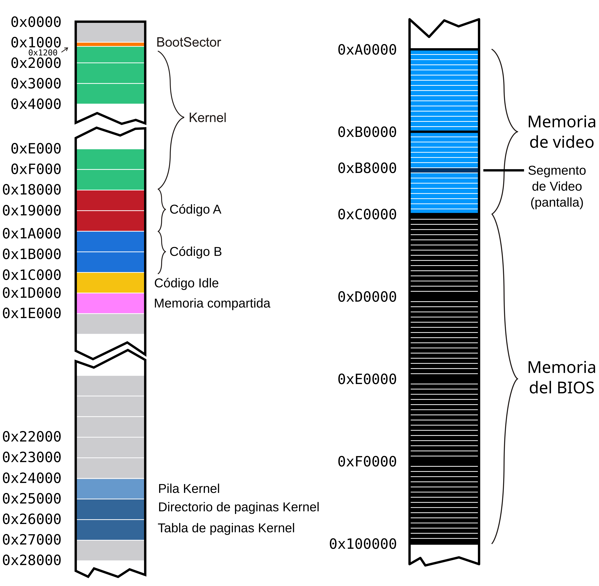
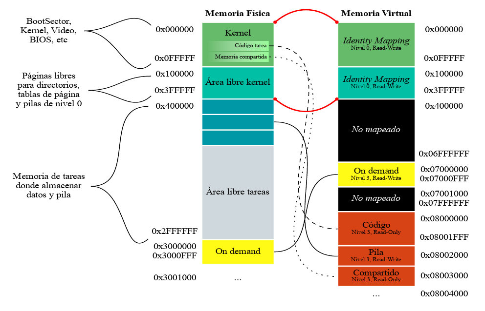

# System Programming: Tareas

Vamos a continuar trabajando con el kernel que estuvimos programando en los talleres anteriores. La idea es incorporar la posibilidad de ejecutar algunas tareas específicas. Para esto vamos a precisar:

- Definir las estructuras de las tareas disponibles para ser ejecutadas.

- Tener un scheduler que determine la tarea a la que le toca ejecutar en un período de tiempo, y el mecanismo para el intercambio de tareas de la CPU.

- Iniciar el kernel con una *tarea inicial* y tener una *tarea idle* para cuando no haya tareas en ejecución.

Recordamos el mapeo de memoria con el que venimos trabajando. Las tareas que vamos a crear en este taller van a ser parte de esta organización de la memoria:





## Archivos provistos

A continuación les pasamos la lista de archivos que forman parte del taller de hoy junto con su descripción:

- **Makefile** - encargado de compilar y generar la imagen delfloppy disk.
- **idle.asm** - código de la tarea Idle.
- **shared.h** -- estructura de la página de memoria compartida
- **tareas/syscall.h** - interfaz para realizar llamadas al sistema desde las tareas
- **tareas/task_lib.h** - Biblioteca con funciones útiles para las tareas
- **tareas/task_prelude.asm**- Código de inicialización para las tareas
- **tareas/taskPong.c** -- código de la tarea que usaremos (**tareas/taskGameOfLife.c, tareas/taskSnake.c, tareas/taskTipear.c **- código de otras tareas de ejemplo)
- **tareas/taskPongScoreboard.c** -- código de la tarea que deberán completar
- **tss.h, tss.c** - definición de estructuras y funciones para el manejo de las TSSs
- **sched.h, sched.c** - scheduler del kernel
- **tasks.h, tasks.c** - Definición de estructuras y funciones para la administración de tareas
- **isr.asm** - Handlers de excepciones y interrupciones (en este caso se proveen las rutinas de atención de interrupciones)
- **task\_defines.h** - Definiciones generales referente a tareas

## Ejercicios

Antes de comenzar, vamos a actualizar el archivo `isr.asm` con algunas syscalls adicionales.

- Reemplazar el código de la `isr88` por
```
pushad
push eax
call tasks_syscall_draw
add esp, 4
popad
iret
```
Esta va a ser una syscall para que una tarea dibuje en su pantalla ¿Cuál es la convención de pasaje de parámetros para esta syscall?

- Verificar que su rutina de atención para las interrupciones del teclado sea funcionalmente igual a esta:
```
pushad
; 1. Le decimos al PIC que vamos a atender la interrupción
call pic_finish1
; 2. Leemos la tecla desde el teclado y la procesamos
in al, 0x60
push eax
call tasks_input_process
add esp, 4
popad
iret
```

- Verificar que la rutina de atención para los pagefault que escribieron en el taller anterior tenga esta forma (recuerden incluir la parte que implementaron para la página compartida a demanda):
```
;; Rutina de atención de Page Fault
;; -------------------------------------------------------------------------- ;;
global _isr14

_isr14:
	; Estamos en un page fault.
	pushad
    ; COMPLETAR: llamar rutina de atención de page fault, pasandole la dirección que se intentó acceder
    .ring0_exception:
	; Acá solo deberíamos llegar si ocurrió un page fault fuera del area compartida.
    call kernel_exception
    jmp $

    .fin:
	popad
	add esp, 4 ; error code
	iret
```
> No olviden comentar la macro `ISRE 14` para que la rutina no quede definida dos veces.

### Primera parte: Inicialización de tareas

**1.** Si queremos definir un sistema que utilice sólo dos tareas, ¿Qué nuevas estructuras, cantidad de nuevas entradas en las estructuras ya definidas, y registros tenemos que configurar? ¿Qué formato tienen? ¿Dónde se encuentran almacenadas?

- Habría que definir dos TSS para guardar el estado de cada una de las tareas con sus respectivos descriptores en la GDT y un selector de segmento en el registro TR para la tarea que queremos ejecutar. La estructura de la TSS contiene los registros de segmento, los registros de proposito general, las flgs y el IP que utilizara la tarea en su ejecucion.

**2.** ¿A qué llamamos cambio de contexto? ¿Cuándo se produce? ¿Qué efecto tiene sobre los registros del procesador? ¿Qué mecanismo provee el procesador para realizar el cambio de contexto? ¿Cuál vamos a usar en su lugar?

**3.** ¿Por qué es necesario cargar el registro **TR** si no vamos a usar ese mecanismo para el cambio de tareas? ¿Qué consideraciones deberíamos tener cuando no tenemos tareas que ejecutar o se encuentran todas suspendidas?

**4.** ¿Qué hace el scheduler de un Sistema Operativo? ¿A qué nos referimos con que usa una política?

- El scheduler determina la siguiente tarea a ejecutar y el tiempo que se le dedica a cada una. En nuestra kernel usa una política Round Robin que le asigna tiempo por igual a las tareas y determina la siguiente iterando sobre ellas de forma circular.

**5.** En un sistema de una única CPU, ¿cómo se hace para que los programas parezcan ejecutarse en simultáneo?

- Se intercambia entre tareas muy rapido para simular que se ejecutan al mismo tiempo.

**6.** En **tss.c** se encuentra definida la TSS de la **Tarea Inicial**, que será la única de nuestro sistema. Ahora, vamos a agregar el *TSS Descriptor* correspondiente a esta tarea en la **GDT**.

a) Escriban el código del método ***tss_init*** de **tss.c** que agrega la entrada a la **GDT** correspondiente al descriptor de TSS de la tarea Inicial.

b) En **kernel.asm**, luego de habilitar paginación, agreguen una llamada a **tss_init** para que efectivamente se agregue a la **GDT**.

c) Correr el *qemu* y usar **info gdt** para verificar que el ***descriptor de tss*** de la tarea Inicial está efectivamente cargada en la GDT.

**7.** Una vez configurada la tss de la **tarea Inicial**, debemos asegurarnos de que el procesador sepa dónde está para poder realizar cambios de nivel de privilegio. Completen lo necesario en **kernel.asm** para que cargue la tarea inicial. Recuerden que la primera vez tenemos que cargar el registro **TR** (Task Register) con la instrucción **LTR**.

Si obtienen un error, asegurense de haber proporcionado un selector de segmento para la tarea inicial. Un selector de segmento no es sólo el indice en la GDT sino que tiene algunos bits con privilegios y el *table indicator*.

**8.** Una vez que el procesador comenzó su ejecución en la **tarea Inicial**, vamos a cambiar el contexto de ejecucuión para pasar a la **tarea Idle**. Esta tarea, definida en `idle.asm` e inicializada en `tasks_init()`, no es más que un loop infinito pensado para mantener ocupado el procesador cuando no hay tareas disponibles para correr. Para eso, vamos a implementar una función en `isr.asm` llamada `switch_to_usermode` cuya tarea será configurar el estado de la pila y de los registros de modo que, al retornar con la instrucción `iret`, el procesador cambie el nivel de privilegio a usuario e inicie la ejecución de la tarea idle. Para eso precisamos considerar: 
- Qué valores precisamos que tengan los registros de propósito general?
  - Para iniciar la tarea Idle no se requieren valores específicos previos en los registros de propósito general, pero para evitar filtrar información del kernel al espacio de usuario, es conveniente inicializar `eax`, `ebx`, `ecx`, `edx`, `esi` y `edi` en `0`. `ebp` y `esp` deben apuntar a la base de la pila de usuario (`TASK_STACK_BASE = 0x08003000`). Nótese que `esp` de nivel 3 no se carga en el registro directamente antes del salto, sino que se coloca en el stack frame del kernel para que la instrucción `iret` lo cargue automáticamente en `ESP` al realizar el cambio de nivel de privilegio.
- Qué esquema de paginación debería estar en uso? (Asegúrense de haber inicializado previamente el directorio de páginas para la tarea idle).
  - Debe estar en uso el directorio de páginas propio de la tarea Idle, es decir, el registro `CR3` debe estar cargado con la dirección física del Page Directory de dicha tarea, inicializado previamente mediante `mmu_init_task_dir(TASK_IDLE_CODE_START)` (donde `TASK_IDLE_CODE_START = 0x0001C000`). Este directorio garantiza:
    1. Identity mapping de los primeros 4 MB del kernel (compartiendo `kpd[0]`) para que al atender futuras interrupciones o excepciones el código del kernel y las estructuras de sistema sigan accesibles.
    2. Mapeo del código de la tarea Idle a partir de la dirección virtual `TASK_CODE_VIRTUAL` (`0x08000000`) como solo lectura en nivel usuario (`MMU_U`).
    3. Mapeo de la pila de la tarea con base en `TASK_STACK_BASE` (`0x08003000`), es decir en `[0x08002000, 0x08003000)`, con permisos de lectura/escritura en nivel usuario (`MMU_U | MMU_W`).
    4. Mapeo de la página compartida en `TASK_SHARED_PAGE` (`0x08003000`) en nivel usuario.
- Cuál debería ser el estado de la pila del kernel?
  - Al momento de ejecutar la instrucción `iret` para cambiar de nivel 0 a nivel 3, la pila del kernel debe contener en su tope un stack frame compuesto por 5 valores de 32 bits en el siguiente orden:
    1. `[ESP + 0]`: `EIP` -> Dirección virtual de la primera instrucción a ejecutar (`TASK_CODE_VIRTUAL = 0x08000000`).
    2. `[ESP + 4]`: `CS` -> Selector de segmento de código de nivel usuario con RPL = 3 (`GDT_CODE_3_SEL`).
    3. `[ESP + 8]`: `EFLAGS` -> Registro de flags con interrupciones habilitadas (`IF = 1`, valor típico `0x202`).
    4. `[ESP + 12]`: `ESP` -> Puntero al tope de la pila de usuario (`TASK_STACK_BASE = 0x08003000`).
    5. `[ESP + 16]`: `SS` -> Selector de segmento de datos/pila de nivel usuario con RPL = 3 (`GDT_DATA_3_SEL`).
  - Al ejecutarse `iret`, la CPU desapila `EIP`, `CS` y `EFLAGS`. Al detectar que `RPL (3) > CPL (0)`, desapila también `ESP` y `SS`, cambiando a modo usuario (CPL = 3) y conmutando a la pila de usuario.
  - Adicionalmente, antes de ejecutar `iret` deben cargarse los registros de segmento de datos `DS`, `ES`, `FS` y `GS` con `GDT_DATA_3_SEL` (`0x23`) para que el código en nivel 3 pueda acceder a memoria sin generar fallos de protección.
  - La pila del kernel (asociada a `tss.esp0 = KERNEL_STACK = 0x25000` y `tss.ss0 = GDT_DATA_0_SEL`) queda limpia en su base (`0x25000`), lista para recibir el contexto que el procesador guardará automáticamente cuando ocurra una interrupción o excepción mientras se ejecuta código en nivel de usuario.

**9.** Llamen a esta función en `kernel.asm` (no se olviden de importarla) y  debugueando verifiquen que el valor del registro **CR3** tiene el valor esperado con **creg**.

**10.** Nuestro objetivo es tener múltiples tareas activas en el sistema, que se turnen para ejecutarse. Para ello necesitamos tener un espacio de memoria en el que guardemos el contexto de ejecución de las tareas para poder desalojarlas del procesador en cualquier punto de su ejecución y restaurarlas más adelante sin que las tareas se enteren. Si revisan `tasks.c` verán que este espacio ya está definido como un array de structs `task_t` definido para almacenar el contexto de ejecución de las tareas. Observen las funciones `create_task` y `tasks_init` y adapten lo implementado en el punto 8 para hacer uso de estas estructuras y funciones. Adapten  `switch_to_usermode` para que busque el estado inicial de la tarea idle en la entrada correspondiente del array de tareas.

### Segunda parte: Poniendo todo en marcha

Ahora nos gustaría que en cada interrupción de reloj se consulte al scheduler si corresponde realizar un cambio de tarea y, en caso afirmativo, lo haga.

**11.**  Para este TP la cátedra ha creado un scheduler que devuelve la próxima tarea a ejecutar.

a)  En los archivos **sched.c** y **sched.h** se encuentran definidos los métodos necesarios para el Scheduler. Expliquen cómo funciona el mismo, es decir, cómo decide cuál es la próxima tarea a ejecutar.

- En `sched.c` la variable global `current_task` almacena el ID de la tarea actualmente en ejecución (un índice entre 0 y `MAX_TASKS - 1`).
- La función `sched_next_task()` implementa una política de planificación **Round Robin** (turno rotativo circular):
  1. Comienza la búsqueda a partir de la siguiente tarea: `i = current_task + 1`.
  2. Itera de manera circular sobre las entradas del array de tareas mediante aritmética modular (`i % MAX_TASKS`) hasta dar una vuelta completa o encontrar una tarea lista para ejecutarse.
  3. Para cada tarea inspecciona su estado en `tasks[i % MAX_TASKS].sched_state`. Si su estado es `TASK_RUNNABLE`, se selecciona como la próxima tarea, se actualiza `current_task = i;` y se retorna dicho índice.
  4. Si tras recorrer todas las tareas ninguna se encuentra en estado `TASK_RUNNABLE` (por ejemplo, si todas están pausadas), la función retorna `0`, lo que significa que se ejecutará la tarea **Idle** (`tasks[0]`).
- Adicionalmente, el scheduler provee funciones auxiliares:
  - `sched_enable_task(task_id)`: Marca la tarea correspondiente como `TASK_RUNNABLE`.
  - `sched_disable_task(task_id)`: Marca la tarea correspondiente como `TASK_PAUSED`.
  - `sched_init()`: Inicializa el scheduler asignando `current_task = 0;` (comenzando en la tarea Idle).

b)  Modifiquen **kernel.asm** para llamar a la función ***sched_init*** luego de inicializar las tareas.

c)  Habrán visto que en `sched.c` se define la variable `current_task` que almacena el id de la tarea que corre actualmente. Modifiquen la rutina de atención de la interrupción del reloj para que ejecute `sched_next_task`.

**12.**  Si adaptamos `switch_to_usermode` para que lea `current_task` y en base a su valor determine qué contexto leer del array de tareas, podremos llamarla al final de la interrupción de reloj para que realice el cambio de contexto a la siguiente tarea (o no) de acuerdo al efecto de `sched_next_task`. Noten que cómo `current_task` se inicializa en `0`, esta modificación no debería afectar el llamado a `switch_to_usermode` desde `kernel.asm`.

**13.** Ya solo nos falta una parte para que las tareas puedan correr concurrentemente: guardar el contexto de la tarea al momento en que fue interrumpida por el reloj. Para ello, implementaremos `save_current_task_context` en `isr.asm` y la llamaremos ni bien comienza la rutina de atención del reloj. Esta función deberá actualizar el elemento correspondiente a la tarea actual en el array de tareas con los valores actuales del procesador. **Cuidado!** Cualquier cosa que hagan que modifique registros estará pisando contexto propio de la tarea, asegurense de resguardar aquello que vayan a pisar y luego leerlo de allí cuando vayan a actualizar el campo correspondiente en el struct de la tarea.

Llegado este punto deberían:
- Haber cargado el selector de tss de la tarea inicial en TR.
- Haber inicializado el scheduler con `sched_init` y las estructuras de las tareas con `tasks_init`.
- Haber implementado la función `switch_to_usermode` de modo que al llamarla cargue en el procesador el contexto guardado de la tarea actual y prepare la pila para reanudar su ejecución tras ejecutar `iret`.
- Haber implementado la función `save_current_task_context` que guarda el contexto de la tarea actual en su elemento correspondiente en el array de tareas.
- Haber modificado la rutina de atención del reloj para que guarde el contexto de la tarea actual, pedirle al scheduler que determine qué tarea debe ejecutarse a continuación y que retome la ejecución de la tarea correspondiente.


### Tercera parte: Tareas? Qué es eso?

**14.** Con todo eso implementado correctamente, deberían poder correr el sistema y ver tres tareas corriendo en simultáneo con las que pueden interactuar. Observen el código de estas superficialmente (se encuentran en la carpeta `src/tareas`).

a) ¿Qué mecanismos usan para comunicarse con el kernel?

- **Llamadas al sistema (Syscalls) mediante interrupciones de software (`int 88`):** Para solicitarle al kernel que realice operaciones privilegiadas (como dibujar en la memoria de video), las tareas utilizan syscalls. Por ejemplo, en `syscall.h`, la función `syscall_draw(screen text)` ejecuta la instrucción `int 88`. Esto provoca una conmutación de nivel de privilegio de usuario a kernel (Ring 3 a Ring 0), donde la rutina `_isr88` recibe el puntero y delega en `tasks_syscall_draw` para volcar los datos en el área correspondiente de la memoria de video (`0xB8000`).

- **Memoria compartida de solo lectura (`ENVIRONMENT` en `0x08003000`):** El kernel mapea una página en `TASK_SHARED_PAGE` (`0x08003000`) en el directorio de cada tarea con atributos de solo lectura a nivel usuario (`MMU_U`). Esta página virtual mapea a la dirección física `0x1D000` del kernel. A través de este mecanismo sin necesidad de syscalls continuas:
  - El kernel actualiza periódicamente `tick_count` en cada tick de reloj (`tasks_tick`). Las tareas consultan este valor para sincronización y esperas (`task_sleep`).
  - El kernel procesa los scancodes del teclado (`tasks_input_process`) y escribe el estado de las teclas en el campo `keyboard`. Las tareas leen directamente si una tecla fue presionada o soltada.
  - El kernel asigna y escribe el `task_id` identificatorio de la instancia actual.

- **Memoria compartida bajo demanda (Page on Demand en `0x07000000`):** Las tareas escriben información compartida a partir de `PAGE_ON_DEMAND_BASE_VADDR` (`0x07000000`). Como esta página no está mapeada inicialmente en la tabla de páginas de la tarea, el primer acceso genera una excepción de Page Fault (`#PF`, `INT 14`), permitiendo que el manejador del kernel (`page_fault_handler`) asigne dinámicamente la página física compartida `ON_DEMAND_MEM_START_PHYSICAL` con permisos de lectura y escritura (`MMU_U | MMU_W`), habilitando la comunicación inter-tarea mediada por el kernel.

b) ¿Por qué creen que no hay uso de variables globales? Piensen en el espacio de memoria que precisarían ¿Qué pasaría si una tarea intentase escribir en él con nuestro sistema?

- **Espacio de memoria requerido y permisos:** Al inicializar el esquema de paginación de una tarea en `mmu_init_task_dir`:
  - Las dos páginas asignadas al código de la tarea (`[0x08000000, 0x08002000)`) se mapean con permisos de **solo lectura** para nivel usuario (`MMU_U`).
  - La única página con permisos de escritura para la tarea es la página de pila (`[0x08002000, 0x08003000)` con `MMU_U | MMU_W`).
  - La página compartida `ENVIRONMENT` (`0x08003000`) es de solo lectura.
  El linker vincula las tareas como binarios planos cargados a partir de `0x08000000`, por lo que no existe una región o segmento separado con páginas físicas asignadas y mapeadas con permisos de escritura.

- **¿Qué pasaría si una tarea intentase escribir en una variable global en nuestro sistema?** Si una tarea definiese una variable global e intentara escribir en ella, la variable se ubicaría en el espacio de direcciones de la tarea (dentro de las páginas de código `0x08000000` - `0x08002000`). Como dichas páginas están marcadas como de solo lectura a nivel usuario (`MMU_U`), la MMU detectará una violación de permisos de acceso en tiempo de ejecución y disparará inmediatamente una excepción de **Page Fault**. Al atender el fallo en `_isr14`:
  1. Se invoca a `page_fault_handler(cr2)`.
  2. Este comprueba si la dirección virtual que falló se encuentra dentro del rango de memoria on-demand (`0x07000000` a `0x07000FFF`).
  3. Como la dirección de la variable global (`0x0800XXXX`) está fuera de dicho rango, `page_fault_handler` devuelve `false` (no se puede resolver el fallo).
  4. La rutina `_isr14` llama a `kernel_exception` y cuelga el sistema en un bucle infinito (`jmp $`), deteniendo por completo la ejecución.

c) La interrupción de reloj es fundamental para la conmutación de tareas. Por defecto, esta interrupción se genera cada 65536 pulsos de un clock de 1193182Hz (ciclos por segundo) llamado PIT (Programmable Interval Timer), es decir, llega la interrupción a una tasa de 1193182 Hz / 65536 = 18,206 Hz. Pero se puede configurar escribiendo el tamaño del intervalo (cantidad de pulsos entre interrupciones) en el puerto 0x40 (16 bits). 65536 no es un valor representable en 16 bits pero se lo puede alcanzar usando 0 para representarlo, aprovechando que este no es un divisor válido. De ahí en adelante los valores se interpretan de forma directa (1 = 1, 2 = 2, ..., 65535 = 65535).

a. Escribir en el timer (puerto 0x40) el valor de cuenta para que las interrupciones lleguen al doble de velocidad.
Tener en cuenta que el bus es de 8 bits, por lo que se deben hacer 2 escrituras consecutivas (parte baja -- parte alta respectivamente).

b. ¿Cómo harían para que la impresión del caracter giratorio sea una vez por segundo?

- Se debe implementar un acumulador/contador de interrupciones (ticks) en la rutina de atención del reloj o en `next_clock`:
1. Se define una variable estática (ej. `clock_ticks: dd 0`).
2. En cada interrupción del reloj se incrementa dicho contador.
3. Cuando el contador alcanza el valor de la frecuencia configurada del PIT, se reinicia el contador a 0 y se procede a avanzar y redibujar el carácter giratorio. Si se desea que realice un giro completo de 4 pasos por segundo (250 ms por cuadrante), el carácter se actualiza cada F/4 ticks (ej. cada 250 ticks a 1000 Hz).

c. ¿Qué pasaría si llevamos la frecuencia de las interrupciones al máximo?

- Si llevamos la frecuencia de las interrupciones al máximo ocurriría una Sobrecarga absoluta de la CPU donde cada interrupción del reloj desencadena el cambio de nivel de privilegio a Ring 0, la ejecución de `_isr32` (`pushad`, `save_current_task_context`, comunicación con el PIC, scheduler Round-Robin, actualización de interfaz y retorno con `switch_to_usermode` e `iret`). Este ciclo de atención insume cientos de ciclos de procesador.
- El procesador permanece el 100% del tiempo atrapado atendiendo interrupciones del reloj.
- Las tareas de nivel de usuario no reciben ciclos de ejecución útiles.
- El sistema no respondería a la interacción del usuario ni al teclado.

d. Establezcan una frecuencia de interrupción que permita el funcionamiento fluido de las tareas.

**15.** Observen **tareas/task_prelude.asm**. El código de este archivo se ubica al principio de las tareas.

a. ¿Por qué la tarea termina en un loop infinito?

- **No existe una dirección de retorno válida en la pila para `_start`:** La pila de nivel 3 fue inicializada en `TASK_STACK_BASE` (`0x08003000`). `_start` es el punto de entrada de la tarea; cuando hace `call task`, se apila la dirección de retorno que apunta a la siguiente instrucción (`jmp $`). Si en lugar de `jmp $` hubiera una instrucción `ret`, el procesador intentaría desapilar una dirección de retorno inexistente de la pila de usuario, extrayendo datos residuales o basura y saltando a una dirección arbitraria de memoria.
- **Prevención de fallos y excepciones críticas (`#UD` / `#PF`):** Si no existiera el salto `jmp $`, el contador de programa (`EIP`) seguiría avanzando secuencialmente en memoria ejecutando lo que se encuentre a continuación y esto dispararía una excepción al sobrepasar el límite de las páginas mapeadas de código (`0x08002000`), provocando una `kernel_exception` que colgaría todo el sistema.
- **Preservación del flujo del Scheduler:** El bucle `jmp $` retiene a la tarea en espera: no realiza operaciones destructivas y permite que el temporizador (PIT) siga interrumpiendo periódicamente para conmutar la CPU a las demás tareas concurrentes.

b. \[Opcional\] ¿Qué podríamos hacer para que esto no sea necesario?

- **Implementar una llamada al sistema de finalización (`sys_exit`):** Modificar el preludio de la tarea para invocar una syscall de terminación tras el retorno de `task`:
  ```nasm
  _start:
      call task
      mov eax, SYS_EXIT
      int 88 ; o la interrupción designada para syscalls
  ```
  En el kernel, al recibir esta syscall en Ring 0:
  1. Se cambia el estado de la tarea en el scheduler: `tasks[current_task].sched_state = TASK_PAUSED;` (o `TASK_SLOT_FREE`).
  2. Se liberan los recursos asignados (página de pila y estructuras de paginación en la MMU).
  3. Se invoca al scheduler (`sched_next_task`) y al conmutador de contexto (`switch_to_usermode`), cediendo de inmediato la CPU a la próxima tarea lista sin desperdiciar los ticks restantes del quantum en un bucle vacío.
- **Preparar la pila inicial con la dirección de salida:** Al inicializar el contexto de la tarea en `create_task`, se puede escribir en el tope de la pila de usuario la dirección de una rutina de salida (`task_exit_stub`), de modo que cuando la función `task()` ejecute la instrucción `ret`, desapile automáticamente esa dirección y salte directamente al código que ejecuta la syscall de terminación.

### Cuarta parte: Hacer nuestra propia tarea

Ahora programaremos nuestra tarea. La idea es disponer de una tarea que imprima el *score* (puntaje) de todos los *Pongs* que se están ejecutando. Para ello utilizaremos la memoria mapeada *on demand* del taller anterior.

#### Análisis:

**16.** Analicen el *Makefile* provisto. ¿Por qué se definen 2 "tipos" de tareas? ¿Como harían para ejecutar una tarea distinta? Cambien la tarea *Snake* por una tarea *PongScoreboard*.

- **¿Por qué se definen 2 "tipos" de tareas?**
  - **Distribución fija de memoria física:** El kernel y el `Makefile` reservan un espacio de memoria física continuo y predeterminado para las tareas inmediatamente a continuación del código del kernel (`0x18000`). En el `Makefile`, `TASKSSIZE` establece un tamaño total fijo de 20 KB:
    - `TASK_A_CODE_START = 0x00018000` (8 KB)
    - `TASK_B_CODE_START = 0x0001A000` (8 KB)
    - `TASK_IDLE_CODE_START = 0x0001C000` (4 KB)
  - **Plantillas de código vs. Instancias:** El sistema distingue entre el *tipo* o programa ejecutable (`tipo_e: TASK_IDLE, TASK_A, TASK_B`) y las instancias en ejecución. En `tasks.c`, `tasks_init()` crea tres instancias de la Tarea A y una de la Tarea B. Todas las instancias del Tipo A comparten las mismas páginas físicas de código en `0x18000`, mapeadas mediante paginación a la misma dirección virtual (`0x08000000`), manteniendo pilas independientes. Definir dos tipos de tareas permite tener dos programas con lógicas completamente diferentes corriendo concurrentemente sin requerir un sistema de archivos ni un cargador dinámico de ejecutables.

- **¿Cómo harían para ejecutar una tarea distinta?**
  - Para sustituir uno de los programas existentes por otro disponible en la carpeta `tareas/` (por ejemplo, cambiar la Tarea B): Basta con modificar la variable correspondiente en el `Makefile`:
    ```makefile
    TASKB=taskPongScoreboard.tsk
    ```

**17.** Mirando la tarea *Pong*, ¿En que posición de memoria escribe esta tarea el puntaje que queremos imprimir? ¿Cómo funciona el mecanismo propuesto para compartir datos entre tareas?

- **Posición de memoria donde escribe el puntaje:**
  - `Dirección Virtual` = 0x07000F00 + (`task_id` * 8)
  - `current_task_record[0]` (Puntaje Player 1): `0x07000F00 + (task_id * 8)`
  - `current_task_record[1]` (Puntaje Player 2): `0x07000F00 + (task_id * 8) + 4`

  Para las tres instancias de Pong del sistema:
  - **Instancia 1 (`task_id = 1`):** `0x07000F08` (Player 1) y `0x07000F0C` (Player 2).
  - **Instancia 2 (`task_id = 2`):** `0x07000F10` (Player 1) y `0x07000F14` (Player 2).
  - **Instancia 3 (`task_id = 3`):** `0x07000F18` (Player 1) y `0x07000F1C` (Player 2).

- **Funcionamiento del mecanismo para compartir datos entre tareas:** El intercambio de datos se implementa mediante **memoria compartida mapeada bajo demanda (Page on Demand)** asistida por excepciones de **Page Fault**:
  1. **Estado inicial:** Al inicializar las estructuras de paginación de cada tarea en `mmu_init_task_dir`, la página virtual `0x07000000` no se encuentra presente en sus tablas de páginas.
  2. **Detección del acceso:** Cuando una tarea intenta leer o escribir por primera vez en cualquier dirección de la página `[0x07000000, 0x07000FFF]`, la MMU detecta que la página no está presente y genera una excepción de Page Fault (`#PF`, vector 14), almacenando la dirección que causó el fallo en el registro de control `CR2`.
  3. **Mapeo dinámico por el Kernel:** La rutina de interrupción `_isr14` delega en la función `page_fault_handler(virt)` en `mmu.c`. Al verificar que la dirección `virt` pertenece al rango on-demand, mapea esa página virtual en el directorio de páginas activo (`CR3`) hacia la página de memoria física compartida **`ON_DEMAND_MEM_START_PHYSICAL = 0x03000000`**, con atributos de usuario y lectura/escritura (`MMU_U | MMU_W`).
  4. **Retorno transparente:** La excepción retorna con `iret`, y la instrucción de acceso a memoria se reintenta, ejecutándose esta vez con éxito.
  5. **Compartición de datos (IPC):** Como todas las tareas que acceden a esta dirección virtual son mapeadas hacia la **misma página física `0x03000000`**, se establece una región de memoria compartida. Las tareas de Pong escriben sus puntajes en sus respectivos índices (`task_id`), y la tarea `PongScoreboard` puede leerlos directamente de esa misma dirección física para mostrarlos en pantalla.

#### Programando:

**18.** Completen el código de la tarea *PongScoreboard* para que imprima en la pantalla el puntaje de todas las instancias de *Pong* usando los datos que nos dejan en la página compartida.

---

### Integradores

**19.** \[Opcional\] Resuman todas las estructuras vistas desde la parte 1 a 4 de este TP. Escriban el funcionamiento general de segmentos, interrupciones, paginación y tareas en los procesadores Intel. ¿Cómo interactúan las estructuras? ¿Qué configuraciones son fundamentales a realizar? ¿Cómo son los niveles de privilegio y acceso a las estructuras?

  ### 1. Resumen de las Estructuras de Datos

  #### A. Segmentación y Modo Protegido (Parte 1)
  - **Registro GDTR y descriptor `gdt_descriptor_t` (`gdt.h`):** Estructura empaquetada de 48 bits (6 bytes):
    - `gdt_length` (16 bits): Límite de la tabla en bytes menos 1 (`sizeof(gdt) - 1`).
    - `gdt_addr` (32 bits): Dirección lineal donde reside el arreglo de descriptores `gdt`.
    - Se carga mediante la instrucción privilegiada `lgdt [GDT_DESC]`.
  - **Descriptor de Segmento `gdt_entry_t` (`gdt.h`):** Estructura de 64 bits alineada a 8 bytes que describe un segmento de memoria:
    - `base_15_0`, `base_23_16`, `base_31_24`: Suman 32 bits que fijan la dirección lineal base del segmento.
    - `limit_15_0`, `limit_19_16`: Suman 20 bits que determinan el tamaño máximo direccionable.
    - `type` (4 bits): Tipo de segmento y permisos (código Ejecución/Lectura = `1010b = 10`, datos Lectura/Escritura = `0010b = 2`, TSS disponible = `1001b = 9`).
    - `s` (1 bit): Descriptor de Sistema (`S = 0`, ej. TSS) o de Código/Datos (`S = 1`).
    - `dpl` (2 bits): *Descriptor Privilege Level* (0 para Kernel, 3 para Usuario).
    - `p` (1 bit): *Present* (1 si el segmento está presente en memoria).
    - `avl` (1 bit): Disponible para uso del sistema operativo.
    - `l` (1 bit): Modo 64 bits (*Long Mode*, 0 en modo protegido de 32 bits).
    - `db` (1 bit): Tamaño por defecto de operandos e instrucciones (1 para código y datos de 32 bits, 0 para 16 bits).
    - `g` (1 bit): *Granularity* (0 = límite interpretado en bytes; 1 = límite multiplicado por 4 KiB).
  - **Descriptores configurados en la GDT (`gdt.c`):**
    - Entrada 0: **Descriptor Nulo** (exigido por hardware; su selector asociado dispara `#GP` si se intenta desreferenciar).
    - Entrada 1: **Código de Kernel (Nivel 0)**: Base `0x00000000`, Límite 817 MiB (`FLAT_SEGM_SIZE`), `Type = Execute/Read`, `S = 1`, `DPL = 0`, `G = 1`, `D/B = 1`.
    - Entrada 2: **Código de Usuario (Nivel 3)**: Idéntico al anterior pero con `DPL = 3`.
    - Entrada 3: **Datos de Kernel (Nivel 0)**: Base `0x00000000`, Límite 817 MiB, `Type = Read/Write`, `S = 1`, `DPL = 0`, `G = 1`, `D/B = 1`.
    - Entrada 4: **Datos de Usuario (Nivel 3)**: Idéntico al anterior pero con `DPL = 3`.
    - Entrada 5: **Segmento de Video**: Base `0x000B8000`, Límite 8000 bytes (pantalla 80x50 caracteres x 2 bytes/celda), `Type = Read/Write`, `S = 1`, `DPL = 0`, `G = 0`, `D/B = 1`.
    - Entrada 11: **Descriptor de TSS (Tarea Inicial)**: Base `&tss`, Límite `sizeof(tss_t) - 1`, `Type = 0x9` (32-bit TSS disponible), `S = 0`, `DPL = 0`, `G = 0`.
  - **Selector de Segmento (16 bits):** Valor numérico cargado en registros de segmento (`CS, DS, ES, SS, FS, GS` y `TR`):
    - Bits 15-3: Índice de la entrada dentro de la GDT (o LDT).
    - Bit 2 (`TI`): *Table Indicator* (0 = GDT, 1 = LDT).
    - Bits 1-0 (`RPL`): *Requested Privilege Level* (0 para Kernel, 3 para Usuario).
    - Ejemplos: `GDT_CODE_0_SEL = 0x08` (idx 1, rpl 0), `GDT_CODE_3_SEL = 0x13` (idx 2, rpl 3), `GDT_DATA_0_SEL = 0x18` (idx 3, rpl 0), `GDT_DATA_3_SEL = 0x23` (idx 4, rpl 3), `GDT_IDX_TASK_INITIAL = 0x58` (idx 11, rpl 0).
  - **Estructura de celda de pantalla `ca` (`screen.h`):** 2 bytes empaquetados (`uint8_t c` para carácter ASCII, `uint8_t a` para atributos de color de fondo y frente).

  #### B. Interrupciones e IDT (Parte 2)
  - **Registro IDTR y descriptor `idt_descriptor_t` (`idt.h`):** Estructura de 48 bits (6 bytes):
    - `idt_length` (16 bits): Límite de la IDT en bytes menos 1 (`sizeof(idt) - 1`).
    - `idt_addr` (32 bits): Dirección lineal del arreglo de compuertas `idt`.
    - Se carga mediante la instrucción privilegiada `lidt [IDT_DESC]`.
  - **Descriptor de Compuerta `idt_entry_t` (`idt.h`):** Estructura de 64 bits (8 bytes) que define una puerta de interrupción:
    - `offset_15_0`, `offset_31_16`: Suman 32 bits con la dirección virtual del manejador (*ISR*).
    - `segsel` (16 bits): Selector del segmento de código donde reside la ISR (`GDT_CODE_0_SEL`).
    - `type` (5 bits): Tipo de compuerta (`0b01110 = 14` para *32-bit Interrupt Gate*).
    - `dpl` (2 bits): Privilegio mínimo requerido para invocar la interrupción por software vía `int n` (0 para interrupciones de hardware y excepciones; 3 para syscalls de usuario).
    - `present` (1 bit): 1 si la compuerta es válida.
  - **Diferencia entre Interrupt Gate y Trap Gate:** Al ingresar por una *Interrupt Gate*, la CPU limpia automáticamente el flag `IF` en `EFLAGS` (deshabilita interrupciones enmascarables para evitar reentrancia crítica); en una *Trap Gate*, `IF` permanece inalterado.
  - **Compuertas configuradas en `idt.c`:**
    - Vectores 0 a 31: Excepciones del procesador Intel (`_isr0` a `_isr31`), con `DPL = 0` y tipo Interrupt Gate. (Ej. Vector 14: `#PF` para Page Fault).
    - Vector 32 (`0x20`): Temporizador PIT (IRQ0 remapeado del PIC1), `DPL = 0`.
    - Vector 33 (`0x21`): Teclado PS/2 (IRQ1 remapeado del PIC1), `DPL = 0`.
    - Vectores 88 (`0x58`) y 98 (`0x62`): Llamadas al sistema (*Syscalls*), configuradas con `DPL = 3` para permitir invocación desde Ring 3 con `int 88` / `int 98`.
  - **Controladores de Interrupciones PIC 8259A (`pic.c`):**
    - Dos chips en cascada (Master en puertos I/O `0x20/0x21` y Slave en `0xA0/0xA1`).
    - Secuencia de inicialización (ICW1 a ICW4): remapea las líneas IRQ0-IRQ7 a los vectores 32-39 (`0x20-0x27`) y las líneas IRQ8-IRQ15 a los vectores 40-47 (`0x28-0x2F`), evitando colisionar con las excepciones 0-31 reservadas por Intel.

  #### C. Paginación y MMU (Parte 3)
  - **Registros de Control vinculados:**
    - `CR0`: Bit 0 (`PE`, *Protection Enable*), Bit 16 (`WP`, *Write Protect* en Ring 0), Bit 31 (`PG`, *Paging Enable*).
    - `CR3` (*PDBR - Page Directory Base Register*): Dirección física base (alineada a 4 KiB, bits 31-12) del Directorio de Páginas activo del contexto de ejecución.
    - `CR2`: Almacena la dirección lineal de 32 bits que originó la última excepción de *Page Fault* (`#PF`).
  - **Entrada de Directorio de Páginas `pd_entry_t` (`mmu.h`, 32 bits / 4 bytes):**
    - Bits 31-12 (`pt`): Dirección física base de la Tabla de Páginas (dividida por 4096).
    - Bits 11-0 (`attrs`): Bits de control y permisos:
      - Bit 0 (`P`): Presente en memoria.
      - Bit 1 (`R/W`): Lectura/Escritura (1 = R/W, 0 = Read Only).
      - Bit 2 (`U/S`): Usuario/Supervisor (1 = User Ring 3, 0 = Supervisor Ring 0-2).
      - Bit 3 (`PWT`): Page Write-Through.
      - Bit 4 (`PCD`): Page Cache Disable.
      - Bit 5 (`A`): Accessed (puesto a 1 por hardware al acceder a la tabla).
      - Bit 7 (`PS`): Page Size (0 para páginas estándar de 4 KiB).
  - **Entrada de Tabla de Páginas `pt_entry_t` (`mmu.h`, 32 bits / 4 bytes):**
    - Bits 31-12 (`page`): Dirección física base de la página física (*Page Frame*) de 4 KiB.
    - Bits 11-0 (`attrs`): Bits de control (`P`, `R/W`, `U/S`, `PWT`, `PCD`, `A`, y Bit 6 `D` = *Dirty*, seteado a 1 por hardware al escribir en la página).
  - **TLB (*Translation Lookaside Buffer*):** Caché asociativa en el microprocesador que acelera la traducción de direcciones virtuales a físicas. Se invalida completamente recargando el registro `CR3` (`mov cr3, reg`) o de forma individual mediante `invlpg`.
  - **Estructuras en memoria física del sistema:**
    - `kpd` (`KERNEL_PAGE_DIR = 0x00025000`): Directorio de páginas del kernel.
    - `kpt_0` (`KERNEL_PAGE_TABLE_0 = 0x00026000`): Tabla de páginas que realiza el *Identity Mapping* de los primeros 4 MiB de memoria (`0x00000000` a `0x003FFFFF`) con atributos supervisor y lectura/escritura (`MMU_P | MMU_W`).
    - Área libre de páginas para kernel: `0x100000` a `0x3FFFFF` (asignadas secuencialmente por `mmu_next_free_kernel_page`).
    - Área libre de páginas para tareas de usuario: `0x400000` a `0x2FFFFFF` (asignadas secuencialmente por `mmu_next_free_user_page`).

  #### D. Tareas y Administración de Contexto (Parte 4)
  - **Task State Segment `tss_t` (`tss.h`, 104 bytes):** Estructura estándar de hardware de IA-32. Contiene espacio para todos los registros del procesador (`EIP, EFLAGS, EAX..EDI, CR3, selectores CS..GS`). En el kernel desarrollado se mantiene una **única TSS del sistema** (`tss`) con los campos esenciales:
    - `ss0 = GDT_DATA_0_SEL`: Selector del segmento de pila para nivel 0.
    - `esp0 = KERNEL_STACK (0x25000)`: Puntero al tope de la pila de kernel donde la CPU conmutará automáticamente al recibir una interrupción, excepción o syscall proveniente de Ring 3.
  - **Registro Task Register (`TR`):** Registro interno de la CPU de 16 bits cargado con `ltr ax`. Apunta al descriptor de la TSS en la GDT.
  - **Estructura de software `task_t` (`task_defines.h`):** Estructura propia del kernel para guardar el contexto de ejecución de cada tarea cuando es desalojada de la CPU:
    - `sched_state`: Estado en el planificador (`TASK_SLOT_FREE`, `TASK_RUNNABLE`, `TASK_PAUSED`).
    - Registros de propósito general: `eax, ebx, ecx, edx, esi, edi, ebp, esp`.
    - Registros de control y flujo: `eip, eflags, cr3`.
  - **Estructuras globales del Scheduler:**
    - `task_t tasks[MAX_TASKS]`: Arreglo de tareas (Tarea 0 = Idle, Tareas 1..3 = Pong tipo A, Tarea 4 = PongScoreboard tipo B).
    - `uint32_t current_task`: Índice de la tarea que está ejecutando actualmente en la CPU.
  - **Estructura de datos compartidos `shared_data_t` (`shared.h`):** Ubicada físicamente en `0x0001D000` y mapeada en el espacio de usuario en `TASK_SHARED_PAGE = 0x08003000` con atributos de solo lectura (`MMU_U`). Contiene:
    - `tick_count`: Contador global de ticks del timer.
    - `keyboard`: Arreglo con el estado de las teclas presionadas/liberadas.
    - `task_id`: Identificador de la tarea en ejecución.

  ### 2. Funcionamiento General de los Mecanismos de la CPU Intel

  #### A. Segmentación
  La unidad de segmentación traduce una **dirección lógica** (compuesta por un *Selector de Segmento* de 16 bits y un *Offset* de 32 bits) a una **dirección lineal** de 32 bits:
  1. La CPU utiliza el índice del selector para ubicar el descriptor en la GDT (o LDT).
  2. Valida los privilegios (`CPL`, `RPL` y `DPL`) y que el `offset <= límite`.
  3. Extrae la dirección base de 32 bits del descriptor y calcula: `Dirección Lineal = Base + Offset`
  4. En el modelo **Flat** utilizado en este proyecto, todos los segmentos de código y datos tienen `Base = 0x00000000` y `Límite = 817 MiB`, por lo que la dirección lineal coincide numéricamente con el offset (`Dirección Lineal = Offset`). El segmento de video constituye una excepción con base en `0x000B8000`.

  #### B. Interrupciones y Excepciones
  Constituyen el mecanismo para desviar el flujo de control hacia el kernel ante eventos externos (hardware), fallos internos (excepciones de CPU) o peticiones explícitas (syscalls):
  1. **Detección:** La CPU recibe una señal (IRQ del PIC), detecta una condición de error (`#PF`, `#GP`, división por cero) o ejecuta una instrucción `int n`.
  2. **Consulta a la IDT:** El vector numérico $n \in [0, 255]$ indexa la IDT para obtener el descriptor de compuerta correspondiente.
  3. **Comprobación de privilegios y cambio de pila:**
        - Si ocurre una transición de usuario a kernel, la CPU lee el registro `TR` para acceder a la TSS.
        - De la TSS extrae `SS0` y `ESP0` y conmuta a la pila del kernel.
        - Apila automáticamente en la pila de Ring 0 el contexto de usuario que permitirá el retorno: `SS_user`, `ESP_user`, `EFLAGS`, `CS_user`, `EIP_user`.
        - Si la excepción genera código de error (como `#PF` vector 14 o `#GP` vector 13), la CPU apila adicionalmente el `Error Code`.
        - Si no hay cambio de privilegio (evento ocurrido ya en Ring 0), la CPU no conmuta de pila y apila únicamente `EFLAGS`, `CS` y `EIP` (y el error code si aplica).
  4. **Ejecución del Handler:** La CPU carga en `CS:EIP` el selector y offset especificados en la compuerta de la IDT y comienza a ejecutar la ISR.
  5. **Retorno atómico (`iret`):** Desapila `EIP`, `CS` y `EFLAGS`. Al advertir que el `RPL` del `CS` desapilado es mayor que el `CPL` actual (3 > 0), desapila también `ESP` y `SS`, restaurando la pila de usuario y devolviendo el procesador al nivel de privilegio 3 de manera transparente.

  #### C. Paginación
  La unidad de paginación traduce una **dirección lineal** de 32 bits a una **dirección física** de memoria mediante un esquema jerárquico de dos niveles cuando `CR0.PG = 1`:
  1. La dirección lineal de 32 bits se descompone en tres campos:
        - **Bits 31-22 (10 bits):** Índice en el *Page Directory* (PDE). Permite seleccionar una de las 1024 entradas del directorio apuntado por `CR3`.
        - **Bits 21-12 (10 bits):** Índice en la *Page Table* (PTE). Permite seleccionar una de las 1024 entradas de la tabla apuntada por la PDE.
        - **Bits 11-0 (12 bits):** *Offset* dentro de la página física de 4 KiB ($2^{12} = 4096$ bytes).
  2. **Traducción paso a paso:**
        - La CPU lee la base física del Page Directory desde `CR3`.
        - Inspecciona la PDE `cr3[dir_idx]`. Si el bit `P` es 0 o se violan los permisos (`U/S` o `R/W`), la CPU aborta la instrucción, guarda la dirección lineal que falló en `CR2` y dispara la excepción `#PF` (vector 14).
        - Si la PDE es válida, extrae la base de la Page Table y lee la PTE `page_table[table_idx]`. Nuevamente comprueba presencia y permisos.
        - Si la PTE es válida, toma los 20 bits superiores de la PTE (dirección base del frame) y concatena los 12 bits inferiores del offset original para componer la **dirección física final**.
  3. **Mapeo por Demanda (Page on Demand):** Permite diferir la asignación de memoria. Al acceder a una página con `P = 0`, el manejador de `#PF` (`page_fault_handler`) verifica si la dirección en `CR2` está dentro del rango previsto (`0x07000000`), asigna y mapea la página física correspondiente con `MMU_P | MMU_U | MMU_W`, purga la TLB y retorna con `iret`, permitiendo que la instrucción reintente el acceso y continúe normalmente.

  #### D. Tareas y Planificación (Multitarea)
  El sistema implementa multitarea apropiativa (*preemptive multitasking*) por software:
  1. **Disparo periódico:** El timer PIT genera interrupciones periódicas (IRQ0 / vector 32) a una frecuencia fija (1000 Hz).
  2. **Resguardo de contexto (`save_current_task_context`):** Al ingresar a `_isr32`, la CPU ya apiló en la pila del kernel `SS, ESP, EFLAGS, CS, EIP`. El kernel ejecuta `pushad` para apilar los registros de propósito general y vuelca todo este estado en la estructura `tasks[current_task]`.
  3. **Selección de la próxima tarea (`sched_next_task`):** El planificador evalúa las tareas en orden circular (*Round-Robin*). Selecciona la siguiente tarea cuyo estado sea `TASK_RUNNABLE` y actualiza `current_task`. Si ninguna está lista, selecciona la tarea `TASK_IDLE` (índice 0).
  4. **Restauración y cambio de contexto (`switch_to_usermode`):**
        - Carga el `CR3` de la nueva tarea (`mov cr3, eax`), cambiando el espacio de direcciones virtuales y conmutando el aislamiento de memoria.
        - Carga los selectores de datos de usuario (`GDT_DATA_3_SEL`) en `DS, ES, FS, GS`.
        - Resetea la pila del kernel a `KERNEL_STACK` (`0x25000`) y construye el stack frame que simula una interrupción: empuja `SS_usr`, `ESP_usr`, `EFLAGS_usr` (con `IF = 1`), `CS_usr` y `EIP_usr`.
        - Restaura los registros de propósito general desde `tasks[current_task]`.
        - Ejecuta `iret`, lo cual desapila el frame, cambia a modo usuario (CPL = 3) y reanuda la tarea en el punto exacto donde había sido interrumpida.

  ### 3. Interacción entre las Estructuras del Sistema

  Ninguna estructura opera de forma aislada; todas colaboran en una secuencia encadenada tanto durante la ejecución de instrucciones de usuario como ante eventos del kernel:

  ```
  +-----------------------------------------------------------------------------------------+
  |                             ESPACIO DE USUARIO (Ring 3)                                 |
  |  Instrucción: mov [0x08002FFC], eax                                                     |
  |                                                                                         |
  |  1. Registro de Segmento (DS / SS) -> Selector 0x23 (idx 4, RPL 3)                      |
  |  2. Consulta GDT (vía GDTR): Descriptor de Datos Ring 3                                 |
  |     Verifica CPL (3) <= DPL (3) y Offset < Límite. Base = 0x00000000                    |
  |     Dirección Lineal = 0x00000000 + 0x08002FFC = 0x08002FFC                             |
  |  3. Unidad de Paginación (MMU): Lee CR3 de la tarea actual                              |
  |     - Directorio de Páginas (kpd_task): Dir Index = bits 31-22 -> PDE                   |
  |     - Tabla de Páginas (pt_task): Table Index = bits 21-12 -> PTE                       |
  |     - Verifica P=1, U/S=1, R/W=1 -> Traduce a Dirección Física en RAM                   |
  +-----------------------------------------------------------------------------------------+
                                            |
                            Llega Tick de Reloj (PIT -> IRQ0)
                                            |
                                            v
  +-----------------------------------------------------------------------------------------+
  |                      TRANSICIÓN A KERNEL (Ring 3 -> Ring 0)                             |
  |                                                                                         |
  |  4. Hardware consulta IDT (vía IDTR) en el vector 32 (Interrupt Gate)                   |
  |  5. Detecta cambio de nivel (CPL 3 -> DPL 0 de ISR):                                    |
  |     - Lee el registro TR -> Ubica Descriptor de TSS en la GDT                           |
  |     - Accede a la estructura TSS -> Lee SS0 (0x18) y ESP0 (0x25000)                     |
  |     - Conmuta a la Pila de Kernel (0x25000)                                             |
  |     - Apila: SS3, ESP3, EFLAGS, CS3, EIP                                                |
  |     - Carga CS = GDT_CODE_0_SEL (CPL pasa a 0) y EIP = _isr32                           |
  +-----------------------------------------------------------------------------------------+
                                            |
                                            v
  +-----------------------------------------------------------------------------------------+
  |                               RUTINA _isr32 (Kernel)                                    |
  |                                                                                         |
  |  6. Guarda contexto en la estructura de software:                                       |
  |     - pushad guarda registros generales en la pila de kernel                            |
  |     - save_current_task_context copia el frame a tasks[current_task]                    |
  |  7. Avisa al PIC (pic_finish1) y planifica con sched_next_task()                        |
  |  8. switch_to_usermode():                                                               |
  |     - Carga el CR3 de la siguiente tarea en el registro CR3                             |
  |     - Arma el frame de iret en KERNEL_STACK con los datos de tasks[next_task]           |
  |     - Restaura registros generales y ejecuta iret                                       |
  +-----------------------------------------------------------------------------------------+
                                            |
                                            v
  +-----------------------------------------------------------------------------------------+
  |                                NUEVA TAREA (Ring 3)                                     |
  |  9. CPU desapila CS y EIP, restaura SS y ESP de usuario, CPL vuelve a 3 y reanuda.      |
  +-----------------------------------------------------------------------------------------+
  ```

  ### 4. Configuraciones Fundamentales a Realizar (Secuencia de Booteo e Inicialización)

  Para pasar desde el encendido en Modo Real hasta la ejecución concurrente de tareas en Modo Protegido, el kernel en `kernel.asm` sigue una secuencia ordenada y estricta:

  1. **Deshabilitar interrupciones (`cli`):** Evita que interrupciones no atendibles interrumpan la CPU antes de inicializar las estructuras protegidas.
  2. **Habilitar la línea A20 (`call A20_enable`):** Habilita el bit 21 del bus de direcciones para poder acceder linealmente por encima de 1 MiB sin experimentar *wraparound*.
  3. **Cargar la GDT (`lgdt [GDT_DESC]`):** Registra la tabla de descriptores globales con los segmentos de código y datos de Ring 0 y Ring 3, y el segmento de video.
  4. **Pasar a Modo Protegido (`CR0.PE = 1`):** Se activa el bit 0 de `CR0` mediante `mov edx, cr0`, `or edx, 1`, `mov cr0, edx`.
  5. **Far Jump a Modo Protegido (`jmp CS_RING_0_SEL:modo_protegido`):** Fuerza a la CPU a vaciar el pipeline de instrucciones pre-decodificadas en 16 bits y recarga el registro visible y la caché oculta de `CS` con los atributos de 32 bits de `GDT_CODE_0_SEL`.
  6. **Inicializar selectores de datos y pila de kernel:** Cargar `DS, ES, GS, FS, SS` con `GDT_DATA_0_SEL` (`0x18`) y apuntar `ESP` y `EBP` a `KERNEL_STACK` (`0x25000`).
  7. **Inicializar paginación de kernel:**
        - `mmu_init_kernel_dir()`: Configura `kpd` (`0x25000`) y `kpt_0` (`0x26000`), estableciendo el *Identity Mapping* de los primeros 4 MiB.
        - Cargar `CR3` con la dirección física de `kpd` (`mov cr3, eax`).
        - Activar el bit de paginación (`CR0.PG = 1`, bit 31).
  8. **Inicializar la TSS del sistema:**
        - `tss_init()`: Inserta el descriptor de TSS de 32 bits en la entrada 11 de la GDT apuntando a `tss` (con `ss0 = GDT_DATA_0_SEL` y `esp0 = 0x25000`).
        - `ltr ax`: Carga el selector `GDT_IDX_TASK_INITIAL` (`0x58`) en el registro `TR`.
  9. **Inicializar el entorno de tareas y scheduler:**
        - `tasks_init()`: Dibuja la interfaz de pantalla y llama a `create_task()` para la tarea Idle y las tareas Pong y Scoreboard, inicializando sus estructuras `task_t` y asignando sus directorios de páginas con `mmu_init_task_dir()`.
        - `sched_init()`: Inicializa el planificador estableciendo `current_task = 0`.
  10. **Inicializar la IDT y los controladores de interrupción:**
        - `idt_init()` y `lidt [IDT_DESC]`: Carga la IDT con los descriptores de excepciones, interrupciones de PIC y syscalls.
        - `pic_reset()` y `pic_enable()`: Remapea los PICs a las bases `0x20` y `0x28` y desenmascara las líneas IRQ0 (reloj) e IRQ1 (teclado).
        - Configurar el temporizador PIT (puertos `0x43` y `0x40`) en Modo 2 a la frecuencia de 1000 Hz.
  11. **Iniciar la primera tarea (`switch_to_usermode`):** Se carga el `CR3` de la tarea inicial (`Idle`), se arma el frame de retorno a Ring 3 en la pila y se ejecuta `iret` con `EFLAGS.IF = 1`, activando concurrentemente las interrupciones y la ejecución en nivel usuario.

  ### 5. Niveles de Privilegio y Reglas de Acceso a las Estructuras

  La arquitectura IA-32 implementa 4 anillos de privilegio concéntricos (*Rings 0 a 3*). En este sistema se utilizan dos: **Ring 0** (Supervisor/Kernel, máximo privilegio) y **Ring 3** (Usuario, mínimo privilegio).

  #### A. Definiciones de Privilegio en Segmentación
  - **CPL (*Current Privilege Level*):** Nivel de privilegio del código en ejecución. Está dado por los 2 bits menos significativos del registro de segmento `CS`. Determina si la CPU ejecuta en Ring 0 o Ring 3.
  - **DPL (*Descriptor Privilege Level*):** Nivel de privilegio fijado en el descriptor del segmento o compuerta (bits 14-13). Define el privilegio requerido para acceder al recurso.
  - **RPL (*Requested Privilege Level*):** Bits 1-0 de un selector de segmento. Permite a código privilegiado operar con permisos restringidos en representación de un llamador de menor privilegio.

  #### B. Reglas de Validación de Accesos
  1. **Acceso a Segmentos de Datos:** Para cargar un selector en un registro de datos (`DS, ES, FS, GS, SS`), el procesador evalúa: `max(CPL,RPL) <= DPL`. El código en Ring 3 (`CPL = 3`) que intente cargar un selector con `DPL = 0` (como `GDT_DATA_0_SEL`) provoca inmediatamente una excepción de *General Protection Fault* (`#GP`, vector 13). De este modo, las tareas no pueden acceder a los datos directos del kernel ni alterar la pila de nivel 0.
  2. **Acceso a Segmentos de Código:**
        - La CPU no permite saltar directamente (`jmp/call`) a segmentos con distinto privilegio (`CPL != DPL` en segmentos no conformes).
        - Para transferir el control a un nivel más privilegiado (Ring 3 a Ring 0), es **obligatorio** atravesar una compuerta (*Gate*) definida en la IDT.
  3. **Acceso a Compuertas de la IDT (Interrupciones y Syscalls):**
        - Cuando una instrucción de software `int n` intenta invocar una compuerta, el hardware verifica: `CPL <= DPL de la compuerta`
        - Las compuertas de excepciones y de interrupciones de hardware se configuran con `DPL = 0`. Si una tarea en Ring 3 intenta ejecutar `int 14` o `int 32`, se viola la regla ($3 \le 0$ es falso) y la CPU dispara un `#GP`.
        - Las syscalls (`int 88` e `int 98`) se configuran con `DPL = 3`. Como $3 \le 3$, la tarea de usuario puede ejecutarlas legítimamente.
        - Para interrupciones de hardware externas (señales físicas de los PICs) o excepciones del procesador generadas internamente por la ALU/MMU, la CPU **omite la comprobación del DPL de la compuerta**, garantizando que el kernel siempre pueda atender eventos críticos del sistema.
        - En todos los casos, el campo `segsel` del descriptor de la compuerta apunta a `GDT_CODE_0_SEL` (`DPL = 0`), lo que provoca que al cruzar la puerta el `CPL` pase automáticamente a 0 (Ring 0).

  #### C. Control de Acceso en Paginación
  A nivel de páginas existen dos niveles de protección regidos por el bit `U/S`:
  - **Supervisor (`U/S = 0`):** Accesible exclusivamente por código que ejecute en Ring 0, 1 o 2 (`CPL < 3`).
  - **User (`U/S = 1`):** Accesible por código ejecutando en cualquier nivel de privilegio, incluido Ring 3 (`CPL = 3`).
  - **Permisos Combinados (Directorio + Tabla):** Rige la política de intersección más restrictiva:
    - Para que una página sea accesible desde Ring 3, **tanto** la PDE como la PTE deben tener `U/S = 1`. Si la PDE tiene `U/S = 0`, todo el bloque de 4 MiB cubierto por esa entrada pertenecerá a supervisor, independientemente de los bits `U/S` de sus tablas.
    - El permiso de escritura (`R/W`) se combina mediante una operación lógica AND: solo se permite escribir desde Ring 3 si **ambos** (`PDE.RW == 1` y `PTE.RW == 1`).
    - En Ring 0, el procesador puede leer y escribir cualquier página con `U/S = 0` o `U/S = 1`. Si el bit `CR0.WP` (*Write Protect*) está habilitado, incluso en Ring 0 se respetará la restricción de solo lectura (`R/W = 0`), impidiendo que el kernel sobreescriba accidentalmente páginas de código.

  #### D. Instrucciones Privilegiadas
  Ciertas instrucciones solo pueden ser ejecutadas si `CPL = 0`:
  - Instrucciones de control de descriptores y tareas: `lgdt`, `lidt`, `lldt`, `ltr`.
  - Instrucciones de estado y control del procesador: `cli`, `sti` (si `CPL > IOPL`), `hlt`.
  - Manipulación de registros de control: `mov cr0, reg`, `mov cr3, reg`, `invlpg`.
  - Si una tarea de Ring 3 intenta ejecutar cualquiera de estas instrucciones, el procesador cancela la instrucción y dispara un fallo de protección `#GP`.

---

**20.** \[Opcional\] ¿Qué pasa cuando una tarea dispara una excepción? ¿Cómo podría mejorarse la respuesta del sistema ante estos eventos?

### Comportamiento actual del sistema ante una excepción en una tarea

Cuando una tarea que corre en espacio de usuario (**Ring 3**, `CPL = 3`) dispara una excepción:

1. **Intervención del hardware de la CPU:**
   - La CPU detecta la excepción y consulta la compuerta correspondiente en la IDT (vectores 0 a 19).
   - Como la compuerta apunta a un descriptor de segmento de código de Ring 0 (`GDT_CODE_0_SEL`), se produce una transición de privilegio de Ring 3 a Ring 0 (`CPL = 0`).
   - El procesador consulta el registro de tarea `TR` y extrae de la TSS los campos `ss0` (`GDT_DATA_0_SEL`) y `esp0` (`KERNEL_STACK = 0x25000`).
   - Conmuta a la pila del kernel y apila automáticamente el contexto de Ring 3 que permite el retorno:
     `SS (usuario)`, `ESP (usuario)`, `EFLAGS`, `CS (usuario, RPL = 3)`, `EIP (instrucción causante)` y, si corresponde según la excepción, el `Error Code`.
2. **Ejecución del manejador en `src/isr.asm` (`ISRc` / `_isr14`):**
   - La macro `ISRc` apila el número de interrupción, los registros de propósito general (`pushad`), los selectores de segmento (`SS, GS, FS, ES, DS, CS`) y los registros de control (`CR4, CR3, CR2, CR0`).
   - Se comprueba el nivel de privilegio de origen leyendo el `CS` apilado:
     ```nasm
     mov edx, [esp + (8*4 + 3*4)]  ; lee el CS guardado en el frame
     cmp edx, CS_RING_0_SEL
     je .ring0_exception
     ```
   - Si `edx != CS_RING_0_SEL`, el código detecta que la excepción fue provocada por una tarea en Ring 3. Sin embargo, en la implementación actual el bloque ejecuta:
     ```nasm
     call kernel_exception
     add esp, 10*4
     popad
     xchg bx, bx
     jmp $
     ```
   - En el caso particular de `_isr14` (Page Fault): se invoca `page_fault_handler(cr2)`. Si la dirección lineal no pertenece al rango de memoria bajo demanda (`[0x07000000, 0x07000FFF]`), el manejador retorna `false`, provocando igualmente la llamada a `kernel_exception` seguida de `jmp $`.
3. **Efecto final sobre el sistema:**
   - `kernel_exception` dibuja en la pantalla la plantilla de excepción (*pantalla de la muerte* con el volcado completo de registros y tope de pila).
   - Inmediatamente el procesador se traba en un bucle infinito `jmp $` con un breakpoint mágico de Bochs (`xchg bx, bx`).
   - **Consecuencia:** El fallo de una sola tarea de usuario detiene y bloquea por completo todo el sistema operativo. El kernel entra en pánico y congela todas las demás tareas concurrentes, eliminando el aislamiento de fallas que debería brindar la arquitectura en modo protegido.

### ¿Cómo podría mejorarse la respuesta del sistema?

En un sistema operativo robusto y multitarea, el fallo de una tarea de usuario nunca debería voltear el kernel ni congelar al resto de las tareas del sistema. La respuesta ante estos eventos podría mejorarse a través de las siguientes estrategias:

#### 1. Terminación Aislada de la Tarea Afectada (*Task Killing*)
En lugar de invocar `kernel_exception` y ejecutar `jmp $` al detectar que `CS != CS_RING_0_SEL`:
- **Identificar la tarea culpable:** A través de la variable global `current_task` del planificador.
- **Deshabilitar la tarea en el scheduler:** `sched_disable_task(current_task);`
- **Liberar los recursos de la tarea:**
    - Liberar la página física de la pila de usuario (`0x08003000`) en el administrador de memoria física (`mmu_free_user_page`).
    - Liberar las páginas dinámicas que haya solicitado (por ejemplo, la página bajo demanda si fue mapeada).
    - Liberar las tablas de páginas y el directorio de páginas asignado a la tarea (`CR3`), limpiando las entradas privadas de usuario.
- **Registrar y notificar el evento:** En lugar de sobrescribir toda la pantalla, imprimir un mensaje de error en una consola de logs del kernel o marcar la tarea como *"Muerta/Crash"* en el Scoreboard o interfaz gráfica.
- **Continuar con la ejecución del sistema:**
    - Descartar el stack frame de la excepción en la pila de kernel (o resetear `ESP = KERNEL_STACK`).
    - Invocar a `sched_next_task()` para seleccionar la siguiente tarea viva (`TASK_RUNNABLE`). Si no hay tareas vivas, se seleccionará la tarea `Idle`.
    - Saltar inmediatamente a la nueva tarea mediante `switch_to_usermode(current_task)` o restaurar su contexto vía `iret`.
- **Resultado:** Las demás tareas siguen corriendo con total normalidad y el sistema se mantiene operativo y receptivo.

#### 2. Reinicio Automático de la Tarea (*Task Recovery*)
Si la tarea es un servicio persistente o de demostración (como el juego Pong):
- En lugar de eliminarla permanentemente, el kernel puede reiniciar su estado de ejecución:
  - Restaurar en `tasks[current_task]` su contexto inicial:
    - `EIP = 0x08000000` (punto de entrada del código).
    - `ESP = 0x08003000` (tope de su pila de usuario).
    - Registros generales en 0.
    - `EFLAGS = 0x202` (con interrupciones habilitadas `IF = 1`).
  - Si la tarea corrompió su espacio de datos, se puede reinstanciar su directorio de páginas o recargar su código/datos.
  - La tarea vuelve a ponerse en `TASK_RUNNABLE` y el scheduler la reanuda desde el principio.

#### 3. Distinción Estricta entre Excepciones de Kernel (Ring 0) y de Usuario (Ring 3)
- **Ring 0 (`CS == CS_RING_0_SEL`):** El kernel debe entrar en pánico (`kernel_exception` + `jmp $`), ya que un fallo en modo supervisor indica corrupción crítica de estructuras internas del sistema operativo de las cuales no es seguro recuperarse automáticamente.
- **Ring 3 (`CS != CS_RING_0_SEL`):** Solo debe afectar a la tarea que cometió la infracción, garantizando la estabilidad, disponibilidad y aislamiento del resto del sistema.